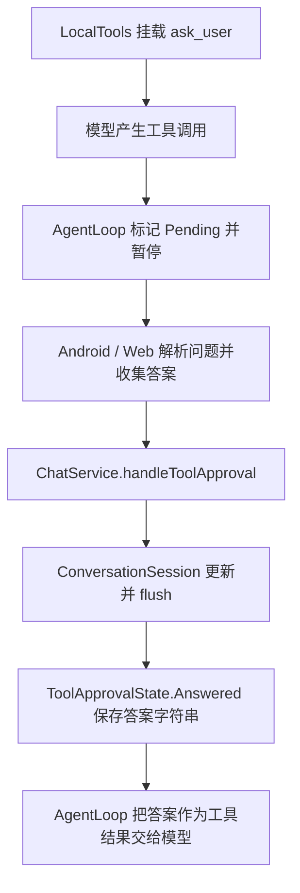

# ask_user 调查与改造计划

日期：2026-10-23。基于本分支与上游 `5dd7b764` 整合后的实现。

状态：协议、Android／Web 界面及回归测试已实现。用户已确认统一可编辑选项方案，并补充了文字区与选择控件的手势规则；下文调查记录描述改造前的行为。

## 建议结论

采用统一的可编辑选项模型：题目只有单选和多选，每道题都支持修改预设、填写自定义答案、追加多条自定义选项。模型只负责提问内容与选择数量，客户端负责编辑、增补、选择和提交。

单选与多选唯一的行为差别是最终选中项数量：单选恰好一项，多选至少一项。预设和自定义项使用同一种状态模型，不再发展出“固定选项”“可编辑预设”“允许其他”“纯输入”等互相组合的参数。

“所有选项可修改”不代表提交所有选项；只提交用户明确选中的最终文字。UI 自动提供自定义输入入口，不代替模型编造有业务含义的预设。没有合理预设时，模型可传空选项数组，用户仍通过同一套交互自由回答。

## 已确认的实现与问题

### 调用链



主要代码入口：

| 文件 | 当前职责 |
| --- | --- |
| `app/src/main/java/me/rerere/rikkahub/data/ai/tools/local/AskUserTool.kt` | 工具说明、JSON Schema、始终要求用户交互 |
| `app/src/main/java/me/rerere/rikkahub/data/ai/tools/local/LocalTools.kt` | 根据助手／会话的本地工具设置挂载工具 |
| `app/src/main/java/me/rerere/rikkahub/ui/components/message/ChatMessageTools.kt` | Android 解析、草稿、选项、提交和历史答案显示，现集中在私有 `AskUserToolStep` 中 |
| `web-ui/app/components/message/parts/tool-part.tsx` | Web 独立实现相同交互和解析 |
| `app/src/main/java/me/rerere/rikkahub/ui/pages/chat/ChatVM.kt` | Android 答案转交服务 |
| `app/src/main/java/me/rerere/rikkahub/web/dto/WebDto.kt`、`web/routes/ConversationRoutes.kt` | Web 审批请求携带 `answer` 字符串 |
| `app/src/main/java/me/rerere/rikkahub/service/ChatService.kt` | 接收答案、更新会话状态、所有待处理工具完成后继续生成 |
| `app/src/main/java/me/rerere/rikkahub/data/model/ConversationMessages.kt` | 拒绝重复提交和不属于当前分支的过期审批 |
| `ai/src/main/java/me/rerere/ai/agent/AgentLoop.kt` | 暂停／恢复，以及将 Answered 内容直接作为工具输出 |

`ask_user.execute` 实际不会运行正常的提问逻辑；它明确抛出“应由 HITL 流程处理”的错误。参数错误也就不会像普通工具一样，在 execute 内被验证并反馈给模型。

### 历史体验与当前代码的区别

历史提交 `05a85a09`（2026-09-08）以前，`single` 和 `multi` 只显示不可编辑的选项，没有自由输入框；`text` 才提供选项加输入框。用户曾经无法让单选题同时容纳预设与自定义输入，与那一版代码的限制一致。

该提交后来给所有类型统一加了输入框，但并未引入真正的可编辑选项。目前 Schema 每题只有 `id`、`question`、`options`、`selection_type`，没有可编辑、预填、自定义等细分参数。因此不能把历史限制全部归因于模型漏填参数；当前问题主要是客户端的数据结构、交互和验证。

### 可从代码确认的缺陷

用户确认“解析失败显示空问题”和“选项不存在／丢失”均是实际遇到过的故障，必须作为回归场景验证。

| 问题 | 当前行为及后果 |
| --- | --- |
| 类型重叠 | `text` 与 `single` 都能显示选项加输入框，模型需要区分两种几乎相同的模式 |
| 单选身份与内容混用 | `answers[q.id]` 同时是选中项和输入框内容；选项是否选中靠文字相等判断。点选预设后可以改输入框，但原选项文字不变，改完高亮就消失 |
| 多选只有一条补充文本 | 预设存在集合里，自定义文本存在另一张映射里，无法为每一条补充答案建立独立、可编辑、可选择的选项 |
| 答案结构丢失 | 多选和自定义文本用 `joinToString(", ")`／`join(", ")` 拼成一个字符串，无法可靠区分答案中的逗号、选项边界、修改来源 |
| Android 解析失败静默消失 | 解析整个题目列表包在一次 `runCatching` 内；任一题的 options 不是字符串数组等错误，会把整份题目变成空列表 |
| 空表单可提交 | Android 的 `questions.all { ... }` 对空列表返回 true，解析失败后可能仍能提交 `{"answers":{}}`；Web 额外检查了题目数，行为不同 |
| ID 未完整校验 | Android 缺失 ID 默认为空字符串，两端都未拒绝重复 ID；以 ID 为键保存答案会互相覆盖 |
| 跨端解析不同 | Android 使用 JsonPrimitive 读取，Web 过滤非字符串；Web 丢弃无 ID／题干的题目，Android 保留空值。同一份异常输入可能得到不同表单 |
| 参数错误没有修复闭环 | `needsApproval = { true }` 在题目有效性检查之前触发等待，错误请求可能把模型停在无法正常回答的界面 |
| 草稿生命周期脆弱 | Android 使用未以工具调用标识隔离的 `remember`，Web 使用组件内状态；重新进入界面／重建组件不保证保留编辑中的内容 |
| 缺少专项测试 | 现有 AgentLoop 测试覆盖 Answered 可恢复，但没有问卷解析、可编辑选项或多选答案无损往返测试 |

## 新输入协议：让模型只决定内容

保留工具名 `ask_user` 和现有字段名，减少迁移成本。新公开协议示例：

```json
{
  "questions": [
    {
      "id": "implementation",
      "question": "这次功能采用哪种实现？",
      "selection_type": "single",
      "options": ["Kotlin + Jetpack Compose", "Java"]
    },
    {
      "id": "targets",
      "question": "需要支持哪些平台？",
      "selection_type": "multi",
      "options": ["Android", "Web"]
    }
  ]
}
```

新 Schema 要求：

- `questions` 至少一题；每题要求非空 `id`、非空 `question`、`selection_type` 和 `options`。
- `selection_type` 只公布 `single` 和 `multi`。纯自由输入统一表达为 `single` 配合 `options: []`。
- `options` 始终是字符串数组，不引入选项对象、默认选中索引或嵌套输入类型。
- 不提供 `allow_custom`、`editable`、`custom_only`、`input_mode` 等开关；所有题目默认具备相同编辑能力。
- 工具说明明确：所有建议都可以修改，用户可以增加答案，返回的是用户最终选中的内容；不要额外生成代表输入入口的“其他／自定义”选项。
- 问题对象关闭额外字段；根对象约束要按现有 `InputSchema.Obj` 的实际序列化能力实现，不能声称配置了一个根本没有传出的根级字段。

预设选项只意味着建议文字，不代表已经选中。打开表单时不自动接受模型的建议。

## 统一内部状态：选项 ID 与文字分开

建议在 `ai` 模块的 provider 无关包中建立问卷协议与解析代码，供 Android 和应用服务共同调用；Web 用相同 JSON fixtures 验证自己的 TypeScript 实现。

```text
QuestionSpec
  id
  question
  selectionType: Single | Multi
  options: List<String>

OptionDraft
  id                     // 客户端生成，不要求模型生成
  origin: Suggested | Custom
  originalText           // 仅建议项保存原文
  text                   // 用户当前编辑文字

QuestionDraft
  questionId
  options: List<OptionDraft>
  selectedOptionIds: Set<OptionId>
```

预设项使用可重建的 ID，例如 `implementation:s0`；自定义项使用草稿中持久保存的唯一 ID。文字重复、修改文字、选中后继续修改，都不能改变该项的身份，也不能与别的项合并。

单选和多选使用同一种 `selectedOptionIds`。通过操作规则限制数量，避免继续维护“文本答案映射”和“多选答案映射”两套来源。

## 客户端交互

沿用聊天消息里的展开式工具步骤，不再加一层答题弹窗。Android 使用现有 Material 3 Expressive 主题和 `CardGroup` 分段组；Web 沿用现有组件系统，行为与答案协议保持一致。

每道题显示题干、明确的“单选／多选”提示，以及纵向选项行。每行包含选择控件、可编辑文字和编辑入口；单选使用单选语义，多选使用复选语义。长文字自然换行，不再挤成无法逐项编辑的小胶囊。

| 操作 | 规定行为 |
| --- | --- |
| 初始化 | 显示模型建议；再自动提供一条空白自定义输入行，初始不选中任何答案 |
| 点选单选项 | 选中此项，取消先前选中项；已经编辑的其他选项保留文字 |
| 点选多选项 | 独立切换此项，不影响其他项 |
| 点击已有内容的文字区 | 单击只选择，双击才进入编辑；已经填写过的自定义项采用相同规则 |
| 点击空白自定义项的文字区 | 单击即可进入输入，不要求双击 |
| 点击左侧选择控件 | 只改变选择状态，单击或双击都不进入编辑；选择控件与文字区独立处理手势 |
| 修改预设 | 原地编辑，保留原文用于还原和结果溯源，编辑后仍是同一个选项 |
| 填写自定义项 | 可写多个句子和逗号，不把标点当作答案分隔符 |
| 添加答案 | “添加选项”增加一条空白自定义行并聚焦；可继续添加多条 |
| 删除自定义项 | 删除该行，同时移除它的选中状态；始终保留至少一个可用的自定义输入入口 |
| 还原预设 | 恢复该预设的原文字，不改变其他项 |
| 切换题目或选择 | 不清空未选项中的编辑草稿 |
| 提交 | 校验所有题目，提交全部题目的有效选中项；提交过程中禁用重复点击 |
| 已回答 | 根据保存的最终答案逐项只读显示，不再根据原选项文字反推用户答案 |

用户已确认编辑与选中的关系：**输入有效内容后自动选中正在编辑的选项；单选切换到该项，多选追加该项。**该规则同时适用于修改预设与填写自定义项。仅聚焦、展开编辑或点“添加选项”不改变选择。

空白自定义行和未选中项不阻止提交，也不进入答案。选中的项被清空时，在该行显示“填写内容或取消选择”，阻止提交，避免静默丢失答案。

移动端要验证窄屏、长中文、系统大字体和键盘遮挡。选择和编辑提供各自清晰的操作区域，触控目标至少 48dp；读屏能读出题型、选中状态和编辑动作。保留键盘导航，输入多行时 Enter 换行，提交通过明确按钮执行。

## 答案输出：统一数组，保留最终文字

答案外层继续经由现有 `answer: String` 传输和保存，字符串内部改为带版本的 JSON。单选和多选都使用选项数组，避免客户端和模型再次面对类型分支：

```json
{
  "version": 2,
  "answers": {
    "implementation": [
      {
        "option_id": "implementation:s0",
        "source": "suggested",
        "text": "Kotlin + Jetpack Compose，兼容 Android 10",
        "original_text": "Kotlin + Jetpack Compose"
      }
    ],
    "targets": [
      {
        "option_id": "targets:s0",
        "source": "suggested",
        "text": "Android",
        "original_text": "Android"
      },
      {
        "option_id": "targets:c0",
        "source": "custom",
        "text": "桌面端，包括 Windows, Linux"
      }
    ]
  }
}
```

- `text` 是用户确认的最终答案；`original_text` 只用于说明预设如何被修改，模型不能把原文当作另一份用户选择。
- 只发送选中项，顺序与界面选项顺序一致；不发送空白输入行或未选草稿。
- `version`、选项 ID、来源和原文均由程序生成，不增加模型构造问题时的参数负担。
- 提交时服务端再次按原问题验证题目 ID、选中数量和非空文字；前端禁用按钮不能代替服务端验证。
- 原来的 `{"answers":{"id":"文本"}}` 继续以只读适配器显示，不按逗号拆解旧答案，因为历史字符串已无法可靠还原多选边界。
- `ToolApprovalState.Answered` 与 Web DTO 的字符串字段继续复用，不需要为答案格式增加 Room 数据库迁移。

## 参数解析与错误恢复

解析、验证、草稿操作、答案编码分别写成可测试函数，Compose／React 只负责呈现。

采用一套明确的兼容规则：

| 输入情况 | 处理 |
| --- | --- |
| 老请求 `selection_type: "text"` | 转为 Single，继续提供全部编辑能力 |
| 缺少 `selection_type` | 按历史默认语义转为 Single；新 Schema 仍要求显式填写 |
| 缺少或为 null 的 `options` | 兼容为空数组，显示自定义输入行 |
| 缺少／空白题目 ID | 按题目原始序号生成稳定 ID，并检查与显式 ID 是否冲突 |
| 重复题目 ID | 明确报错，避免答案互相覆盖 |
| 空题干、未知题型、options 类型错误、非字符串选项、无有效题目 | 报结构化参数错误，指出字段路径；不静默丢题，也不显示可提交的空问卷 |
| JSON 尚在流式生成 | 展示加载态，不把半截 JSON 当成最终错误 |
| 工具输入最终仍为非法 JSON | 报可修复的参数错误，禁止空答案提交 |

在审批前验证新请求：给通用 `Tool` 增加默认不启用的输入验证回调，`ask_user` 注册上述验证器，`AgentLoop` 在转 Pending 之前调用。无效请求写成非空的结构化工具错误输出，让模型有机会修正，避免卡在 HITL 等待。通用循环不依赖 app 包，也不硬编码问卷解析规则。

对历史已经处于 Pending 的异常调用，界面显示具体错误，并提供取消该次提问／返回继续对话的操作。拒绝和停止沿用现有工具生命周期，不以空答案假装完成。新旧输入解析结果使用相同 fixtures，Android 和 Web 必须一致。

## 草稿、会话和并发

- 草稿以会话 ID、工具调用 ID、题目 ID、选项 ID 隔离；Android 放在 ViewModel 并通过 SavedStateHandle 恢复，Web 放在当前浏览器会话存储。
- 恢复草稿时验证问题规格指纹，防止把旧调用的编辑套到另一份题目上。进行中的流式输入不参与答题草稿初始化。
- 草稿留在本客户端，不直接改写 Conversation 快照，也不在用户提交前注入模型上下文。
- 提交仍调用 `ChatService`，通过 `ConversationSession` 最新状态更新和 `flush()` 持久化；保留 `withToolApproval` 对重复提交、旧分支、过期调用的防护。
- 若 Android 和 Web 同时回答，以服务层接受的第一次有效待处理状态更新为准；另一个客户端展示已经保存的结果。
- 提交成功后清理本次草稿；发生可恢复提交错误时保留内容。取消、删除会话与切换分支不得误恢复或提交其他调用的草稿。

## 实施顺序

1. **先固定协议和 fixtures。** 新建问卷规格、纯解析器、选项草稿 reducer、结果编码器及旧答案适配器，覆盖历史输入与异常输入；先不动已有界面。
2. **接入审批前验证和提交校验。** 仅 ask_user 启用输入验证，验证不会影响其他本地工具、MCP、审批和生成恢复；复用现有会话更新链路。
3. **替换 Android 问答组件。** 从 `ChatMessageTools.kt` 拆出独立组件，使用统一选项列表和草稿状态；补齐修改、还原、添加、删除、验证、恢复与只读答案显示。
4. **同步 Web。** 使用相同输入／输出协议和 fixtures，替换双映射与逗号字符串；支持草稿恢复和提交错误显示，运行类型检查、构建并更新嵌入式静态产物。
5. **发布新 Schema。** 在两端都能读取新旧数据后，把公开题型收敛为 single／multi，删除旧的 text 描述和无效状态分支；历史兼容留在适配器。
6. **完整验收。** 编译与测试通过后，在设备和浏览器上验证窄屏、键盘、旋转、历史消息和多客户端提交。按功能阶段提交，便于审阅和定位回归。

## 验收用例

| 范围 | 必须通过的场景 |
| --- | --- |
| 单选 | 选预设、修改预设、填写自定义、增加多个自定义后选择其中一个；最终只提交一项 |
| 多选 | 同时选修改后的预设与两条自定义答案；取消或删除一项不影响其他项 |
| 可编辑性 | 每个预设和自定义行均可独立修改；改字不丢 ID，相同文案不互相影响 |
| 手势隔离 | 已有文字单击不弹输入、双击文字才编辑；空自定义项单击可输入；双击左侧控件绝不打开编辑器 |
| 无预设题 | `options: []` 直接填写并提交，不增加第三种题型 |
| 无损往返 | 中文、英文逗号、换行、引号、Emoji 和很长的答案，编码／解码后文字和选项边界不变 |
| 验证 | 空 questions、重复 ID、坏 JSON、未知类型、对象选项、选中空项均给出明确错误；不提交空问卷 |
| 兼容 | 老 text／single／multi 输入与历史字符串答案可读；旧逗号字符串不被擅自拆分 |
| 生命周期 | 旋转、导航返回、系统恢复、Web 刷新不丢有效草稿；切换调用不串答案 |
| 状态机 | 双击提交、两个客户端竞争、停止、拒绝、切换分支后旧提交均不重复执行；全部待处理工具完成后正常继续生成 |
| 跨端 | 同一份 fixture 在 Android 和 Web 归一化结果、选择行为和最终答案一致 |

自动化验证包括协议与 reducer 单元测试、AgentLoop 暂停／恢复测试、ChatService 提交校验测试、Compose 交互测试及 Web 解析／编码测试。接入真实模型的验证以可观察的成功率为准：记录合法参数、正确显示、完成提交和成功恢复生成四个阶段，不把单次模型表现当作稳定性结论。

## 本轮范围与后续边界

上游 8 项更新的整合已完成。用户随后授权实施问卷协议、交互、草稿与跨端改造，并确认输入有效内容后自动选中以及上述手势规则。历史输入和答案通过兼容适配器读取。

通用工具的批准／拒绝语义保持现状；统一可编辑选项只作用于 `ask_user` 的咨询和澄清流程。

## 实施与验证记录

- `ai/.../interaction/AskUser.kt` 实现统一解析、稳定选项身份、编辑／选择状态、v2 答案编码和旧答案读取。Android 与 Web 使用同一份输入 fixtures 校验兼容和错误行为。
- 无效的新调用在审批前返回包含字段路径的工具错误，模型可修正后重新提问；历史异常调用显示明确错误和取消入口。提交答案在会话最新待处理状态上再次验证。
- Android 与 Web 均支持文字单击选择／双击编辑、空自定义行单击输入、独立的左侧选择控件、自动选中编辑项、添加／移除自定义项和还原预设。
- Android 草稿使用会话级 ViewModel 与 SavedStateHandle，Web 使用 sessionStorage；两端按会话和调用隔离，输入变更时不会复用旧问卷草稿。
- 已通过：283 项 ai、16 项 search、511 项 app JVM 测试（共 810 项）、5 项 Web 协议测试、Web 类型检查及生产构建、GitHub Debug 应用和 Android 测试包构建、Spotless 格式检查。
- 真实 Chrome 已验证：文字／选择控件手势隔离、单选自动切换、多选追加自定义、刷新恢复、结构化答案提交、异常参数提示，以及桌面和 390px 窄屏无横向溢出。
- Android Compose 手势测试已加入并编译；当前没有可用设备或模拟器，尚未执行设备测试。真实模型的参数稳定性仍需后续实际使用验证。
